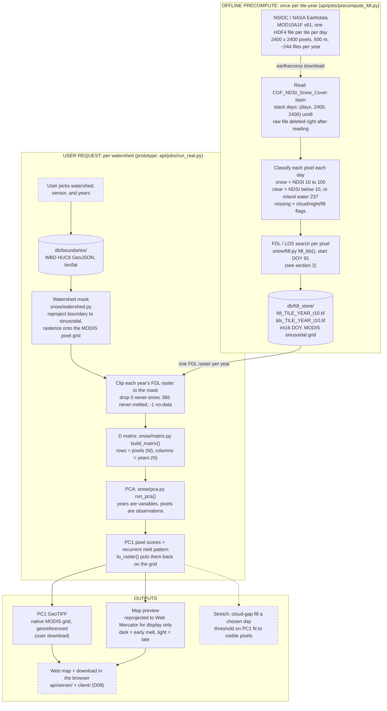
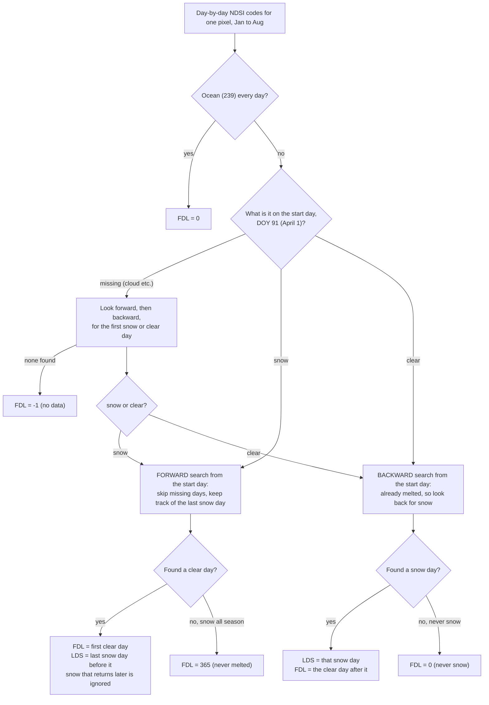
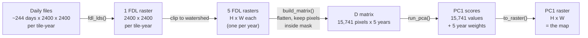

# Data pipeline, start to finish

How satellite snow data becomes a recurring-snowmelt map, and which file in `api/` does each step. GitHub renders the diagrams below; in VS Code, use a Mermaid preview extension.

Legend: **solid boxes are built**, *dashed boxes are planned* (not built yet). Status as of 2026-10-20.

## 1. The big picture

The work splits into two halves. The **offline precompute** is slow (minutes per tile-year) and runs once per year of data. The **user request** is fast (seconds) and runs every time someone picks a watershed.

Note on the prototype: today `run_real.py` computes FDL itself from raw files in `db/raw/` (downloaded by `jobs/download.py`) rather than reading `db/fdl_store/`. Same math, same output; the planned server will read the store so users never wait on the daily-imagery scan.

## 2. What the FDL step does to one pixel in one year

This is the part in `snow/fdl.py` (fixed copy of Woodruff's `reference/Starter_Code_FDL_LDS_MOD10A1F.py`). It runs on every pixel at once with numpy, but the logic for a single pixel is:

Before PCA, the codes **0, 365 and -1 are masked out**: they aren't melt dates.

## 3. How the shapes change

Example numbers are the South Fork Boise (HUC8 17050113), 2020-2024, from the 2026-10-06 run.

Things that trip people up:

- **Columns are years, not days.** Each year's whole melt season collapses into one number per pixel (its FDL) before PCA ever sees it.
- **The map is the pixel scores, not the eigenvector.** The eigenvector has one weight per year (how much each year agrees with the pattern); it can't be mapped.
- **PC1 is relative timing.** Darker pixels melt earlier than lighter ones in a typical year. It is not a calendar date or a snow amount.
- **The boundary moves to the raster, never the reverse.** The watershed polygon is reprojected into MODIS sinusoidal and rasterized onto the existing pixels; the satellite data is never resampled. Web Mercator is used only to draw the preview.
- **Every year's raster must be on the identical grid** (same CRS, transform, size, pixel order), or row *i* of D wouldn't be the same place on the ground in every column.

## 4. Where to find each step

| Step | Code | Command (run from `api/`) |
|---|---|---|
| Earthdata login | `jobs/download.py` `login()` | once, see `get_EarthData_Access.md` |
| Download raw daily files | `jobs/download.py` | `python -m jobs.download ...` |
| Precompute FDL/LDS into the store | `jobs/precompute_fdl.py` | `python -m jobs.precompute_fdl --years 2020 2021 2022` |
| FDL/LDS algorithm | `snow/fdl.py` `fdl_lds()` | |
| Watershed mask, grid, GeoTIFF writer | `snow/watershed.py` | |
| D matrix and back | `snow/matrix.py` `build_matrix()`, `to_raster()` | |
| PCA | `snow/pca.py` `run_pca()` | |
| End-to-end prototype (one watershed) | `jobs/run_real.py` | `python -m jobs.run_real --years 2020 2021 2022 2023 2024` |
| Web server / front end | `server/`, `client/` | not started (D09) |

Open choices that affect this pipeline are tracked in `Planning/decisions.md`: covariance vs. correlation PCA (D06), HUC level and pixel inclusion rule (D08), stack (D09), VIIRS product (D02/D03), and tile stitching for watersheds that span more than one MODIS tile.
